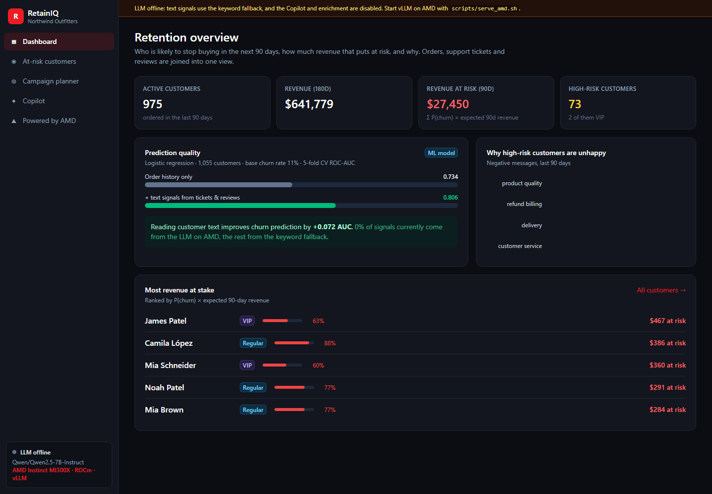
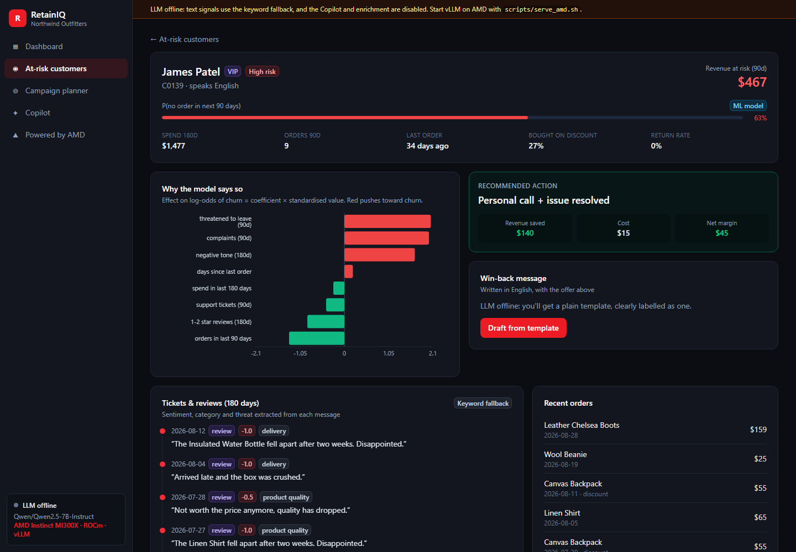
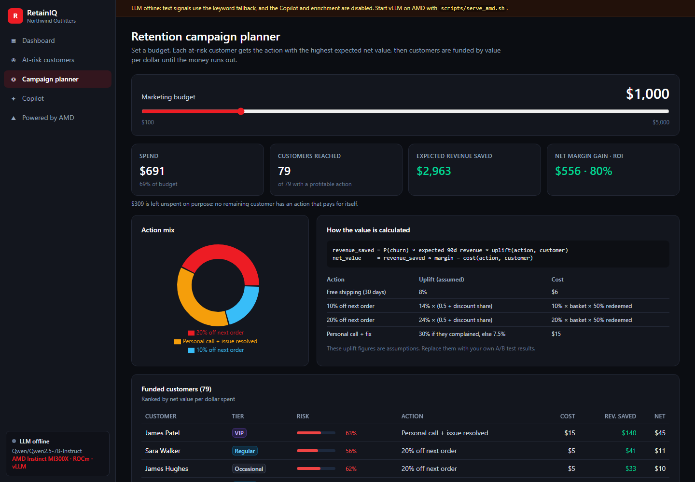
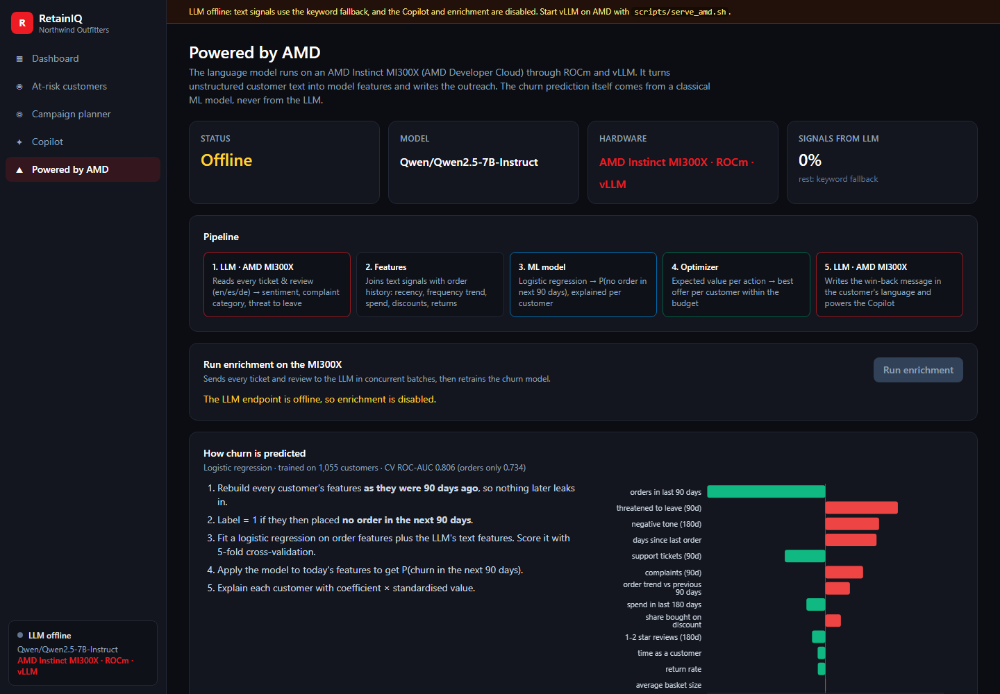

# RetainIQ: churn prevention powered by AMD

**AMD Developer Hackathon Act III · Track 3: Reinvent Commerce**

RetainIQ tells an online retailer which customers are about to stop buying, why, and what
to do about each of them within a marketing budget. It then writes the win-back message in
the customer's own language.

```
/risk 8 $
 ID     Name           Tier     Churn risk       Spend 180d  $ at risk  Why
 C0139  James Patel    VIP      ██████░░░░  63%      $1,477       $467  threatened to leave; recent complaints; ...
/customer C0139  →  Recommended: Personal call + issue resolved · revenue saved $140 · cost $15
/plan 1000       →  79 customers · revenue saved $2,963 · net margin +$556 · ROI 80%
```

## The problem

A store's churn signals live in places that don't talk to each other. Orders sit in the
shop database, complaints in the help desk, and 1-star reviews on product pages. By the time
someone notices that a customer has stopped buying, the customer is gone. The usual fix is a
blanket discount, which spends margin on people who were never going to leave.

## How it works

```
 tickets + reviews ──► LLM on AMD GPUs ──► sentiment · category · "threat to leave"
 (en / es / de)        (Token Factory or            │
                        MI300X + vLLM)              │
                                                       ▼
 orders + catalogue ───────────────────────► features per customer ──► logistic regression ──► P(churn, 90d)
                                                                                                    │
                                    budget ──► expected-value optimizer ◄─────────────── drivers ───┘
                                                       │
                                                       ▼
                         who gets which offer · $ saved · ROI ──► LLM writes the message (on AMD)
```

| Step | Technology | Where |
|---|---|---|
| Read ~6,700 tickets and reviews into structured signals | DeepSeek-V4-Flash on **AMD Token Factory** (default), or your own model on an **AMD Instinct MI300X** with ROCm + vLLM | `signals.py` |
| Predict churn and explain it | scikit-learn logistic regression (no LLM) | `model.py` |
| Choose actions under a budget | Expected-value optimizer | `optimizer.py` |
| Personalized win-back messages, multilingual | LLM on AMD | `engine.py` |
| Free-text questions answered with tool calls | LLM on AMD + function calling | `agent.py`, `tools.py` |

### How the churn prediction is calculated

1. Rebuild every customer's features **as they were 90 days ago**, so nothing after that date leaks in.
2. Label = 1 if the customer then placed **no order in the next 90 days**.
3. Fit a logistic regression on 8 order features (recency, frequency trend, spend, discount share,
   returns, …) plus 5 text features from the LLM (complaints, negative tone, threats to leave, …).
4. Apply the fitted model to today's features to get P(churn in the next 90 days).
5. Explain each score with **coefficient × standardized value** for every feature.

The LLM never predicts churn. It turns free text into features. On the demo data, adding those
text features raises 5-fold cross-validated **ROC-AUC from 0.734 to 0.806**. That gain is what
reading tickets and reviews adds.

### How actions are chosen

```
revenue_saved = P(churn) × expected 90-day revenue × uplift(action, customer)
net_value     = revenue_saved × margin − cost(action, customer)
```

The four actions are free shipping, a 10% coupon, a 20% coupon and a personal call. Uplift is
personalized: coupons work better on deal-seekers, and a personal call works only when there is
a complaint to fix. Each customer gets their best action with positive net value. The budget is
then filled in order of value per dollar. **Uplift and cost figures are stated assumptions** in
one table in `optimizer.py`, so a merchant can replace them with their own A/B test results.

## Run it

**Locally (no GPU needed for the analytics):**

```bash
python -m venv .venv
.venv\Scripts\activate          # Windows  (source .venv/bin/activate on Linux/macOS)
pip install -r requirements.txt
cp .env.example .env
python main.py --demo           # scripted walkthrough
python main.py                  # interactive
```

If no LLM is reachable, RetainIQ falls back to keyword signals and template messages, and
labels them that way on screen. The analytics still work.

### Which AMD service runs the LLM

| Profile (`LLM_PROVIDER`) | AMD service | Cost and limits | How RetainIQ uses it |
|---|---|---|---|
| `token_factory` (default) | **AMD Token Factory**: shared OpenAI-compatible endpoints on AMD GPUs | Free · per team key: 20 requests/min, 8 concurrent, $1/day | 50 messages per request, at most 18 requests/min and 7 at once |
| `vllm` | **AMD Developer Cloud**: your own model on an Instinct MI300X (ROCm + vLLM) | Credits · no rate limits | 1 message per request, 32 at once, and vLLM batches them on the GPU |

**AMD Token Factory (the full product, free):**

1. Sign in at [notebooks.amd.com/tokenfactory](https://notebooks.amd.com/tokenfactory) with
   your AMD AI Developer Program account and redeem the team API key.
2. Put it in `.env` as `LLM_API_KEY=rc-…`. `.env` is gitignored; never commit the key.
3. Run `python main.py`, then `/enrich`.

`/enrich` shows its cost up front (messages, requests and an estimated time), then a progress bar.
At the end it shows tokens/s and the model's ROC-AUC before and after. It saves after every batch,
so Ctrl+C is safe: run `/enrich` again to resume, or `/enrich all` to re-read everything.
Rate limits (429) are retried using the server's `Retry-After`. A bad key or a retired model
stops the run straight away with a clear message.

**Your own model on an AMD Instinct MI300X (optional):**

```bash
bash scripts/serve_amd.sh                     # on the droplet
ssh -N -L 8000:localhost:8000 root@<droplet-ip>   # on your laptop
# .env: LLM_PROVIDER=vllm  LLM_API_KEY=EMPTY
python main.py
```

## Web app

A FastAPI backend (`api/`) and a React frontend (`frontend/`) sit on top of the same `Engine`.
They don't change what the system calculates. They only add HTTP and a browser UI.

| Dashboard | Customer 360 |
|---|---|
|  |  |
| **Campaign planner** | **Powered by AMD** |
|  |  |

**Development** (two terminals):

```bash
uvicorn api.main:app --reload --port 8080        # API, docs at http://localhost:8080/docs
cd frontend && npm install && npm run dev         # UI at http://localhost:5173 (proxies /api)
```

**Production (one URL):** `bash scripts/run_web.sh` builds React and serves the UI and API
on `:8080`. With Token Factory the app needs no GPU, so any small CPU host works (Render,
Railway, Fly.io, a Hugging Face Space). Set the `.env` values as host secrets. With the `vllm`
profile, run it on the MI300X droplet next to `scripts/serve_amd.sh`.

| Endpoint | Purpose |
|---|---|
| `GET /api/health` | LLM status, model, hardware, share of LLM-extracted signals |
| `GET /api/dashboard` | KPIs, CV ROC-AUC (orders only vs. with text), top complaints |
| `GET /api/customers/at-risk?limit&tier&sort=prob\|value` | At-risk list with reasons |
| `GET /api/customers/{id}` | Customer 360: contributions, messages, orders, best action |
| `POST /api/customers/{id}/message` | Win-back message (`source: llm` or `template`) |
| `POST /api/campaigns/plan` `{budget}` | Budget-optimized campaign |
| `GET /api/model` | Model weights and accuracy |
| `POST /api/enrich` · `GET /api/enrich/status` | LLM enrichment on AMD as a background job (409 if already running) |
| `POST /api/agent/chat` `{session_id, message}` | Copilot, streamed as Server-Sent Events: `tool` → `answer` → `done` |

When the LLM is unavailable, `/api/enrich` and `/api/agent/chat` return 503 with the reason
(unreachable, bad key, model retired), and every other endpoint keeps working on the keyword
fallback. `/api/health` reports the provider and the remaining daily quota. `/api/enrich/status`
returns the plan for the next run (pending messages, requests, estimated minutes). Chat streams
`status` events while it waits on a rate limit. Tests: `pytest -q`. They cover every
endpoint with the LLM offline, the enrich job and SSE chat against a mocked LLM, and the rate
limiter, 429 retries, batch parsing and resume logic. Tests never call the real endpoint.

## Commands

| Command | What it does |
|---|---|
| `/dashboard` | Revenue at risk, high-risk counts, model accuracy, top complaint types |
| `/risk [n] [tier] [$]` | Riskiest customers with reasons (`$` sorts by revenue at risk) |
| `/customer <id>` | Customer 360: score, feature contributions, tickets and reviews, best action |
| `/plan <budget>` | Budget-optimized campaign: who gets what, revenue saved, ROI |
| `/message <id>` | Personalized win-back message in the customer's language |
| `/enrich` | Re-read all text with the LLM on AMD and retrain |
| `/model` | How the prediction is made, with model weights |
| anything else | Ask the agent, e.g. *"Which VIPs should I call this week, and why?"* |

## Project layout

```
main.py                 CLI wiring: REPL, slash commands, --demo
retainiq/
  config.py             paths, dates, LLM endpoint (.env)
  data.py               the 4 data sources (synthetic, seeded, causally structured)
  llm.py                OpenAI-compatible client for vLLM on AMD
  prompts.py            every prompt in one place
  signals.py            text → sentiment / category / threat (LLM, keyword fallback)
  features.py           joins the sources into one row per customer, as of a date
  model.py              logistic regression, CV ROC-AUC, per-customer explanations
  optimizer.py          action economics and budget allocation
  engine.py             the pipeline in one object (used by the CLI, the agent, and a future web UI)
  serializers.py        Engine results → JSON (shared by the agent tools and the API)
  tools.py · agent.py   tool-calling agent
  ui.py                 all terminal rendering (rich)
api/
  main.py               FastAPI app: lifespan builds ONE Engine, serves frontend/dist in prod
  deps.py               shared state: engine, enrichment lock + job, chat sessions
  schemas.py            Pydantic request/response models
  routers/              system · dashboard · customers · campaigns · model · enrich · agent
frontend/src/
  api/                  typed client, types mirroring schemas.py, SSE reader
  hooks/                TanStack Query hooks, enrichment poller, chat state
  components/           Layout, KPI cards, risk bars, charts, timeline, action card
  pages/                Dashboard · Customers · Customer360 · Campaign · Copilot · Amd (lazy-loaded)
tests/                  API tests (LLM offline) + LLM paths with a mocked client
scripts/serve_amd.sh    vLLM on ROCm / MI300X
scripts/run_web.sh      build React + serve everything on one port
```

## About the data

There is no public dataset that links one customer's orders to their support tickets and
reviews, so `data.py` generates one: 1,200 customers, about 18,000 orders, and about 6,700
tickets and reviews in English, Spanish and German. It is seeded and causally structured: a bad
experience leads to complaints, then fewer orders, then often churn. Some customers also leave
silently, and some complain but stay. To use real data, replace the CSVs in `data/` with files
that have the same columns.

## Next

Auth and a database, live connectors (Shopify, Zendesk), and uplift values learned from real
campaign results and editable in the UI.
